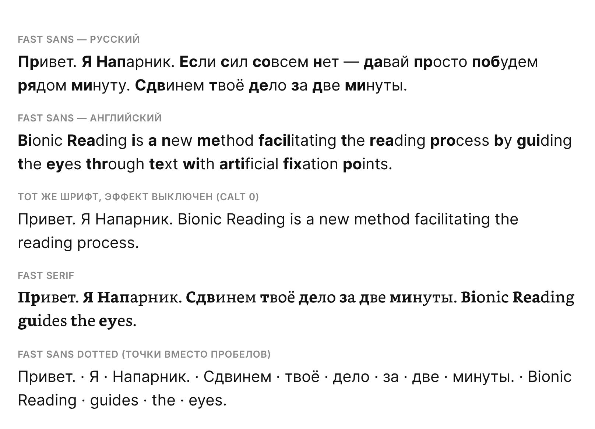

# Bionic Reading — шрифт быстрого чтения

Шрифт, в котором приём **Bionic Reading** встроен в сам шрифт: начало каждого слова автоматически
жирнее, глаз цепляется за него, а мозг достраивает слово. Ничего обрабатывать в тексте не нужно —
достаточно указать шрифт.

Это **Fast-Font** проекта [Born2Root/Fast-Font](https://github.com/Born2Root/Fast-Font), лицензия **MIT**
(`LICENSE-MIT.txt`) — можно использовать и на сайте, и в коммерческих материалах. Файлы взяты как есть,
без изменений, из коммита `aeae0775` (2026-06-18) и переименованы под нашу библиотеку.



## Файлы

| Файл | Что это |
|---|---|
| `BionicReading-Sans.ttf` | Основной, без засечек. Кириллица и латиница. |
| `BionicReading-Serif.ttf` | С засечками. Кириллица и латиница. |
| `BionicReading-Mono.ttf` | Моноширинный, для кода. Кириллица и латиница. |
| `BionicReading-Sans-Dotted.ttf` | Как Sans, но между словами точка — для «чтения по пробелам». |
| `BionicReading-OpenDyslexic.ttf` | На основе OpenDyslexic (сам OpenDyslexic — лицензия SIL OFL), для людей с дислексией. |

Проверено 22.10: у Sans, Serif и Mono полный русский алфавит, эффект работает на русском и английском.

## Как работает и как подключить

Эффект — это стандартная функция шрифта «контекстные альтернативы» (`calt`). В браузерах она включена
по умолчанию:

```css
@font-face {
  font-family: "Bionic Reading";
  src: url("BionicReading-Sans.ttf") format("truetype");
}
.bionic { font-family: "Bionic Reading", sans-serif; }
/* выключить эффект, оставив шрифт: */
.bionic-off { font-feature-settings: "calt" 0; }
```

В Word: выделить текст → Шрифт → Дополнительно → включить «Контекстные альтернативы».
В Figma / After Effects / CapCut: просто выбрать установленный шрифт, `calt` обычно включён.

## Правила библиотеки

- `fonts-library/` — наша постоянная библиотека шрифтов: каждый шрифт в своей папке, с исходными
  файлами, лицензией, образцом и этим описанием. В сборку сайта она не входит.
- Шрифты для самого сайта собираются отдельно (`design/fonts/build.py` → `public/fonts`).
  Чтобы использовать шрифт отсюда на сайте, его подключают через тот же генератор.
- Кладём только шрифты с лицензией, разрешающей наше использование. Платные и «только для личного
  использования» — нет.
